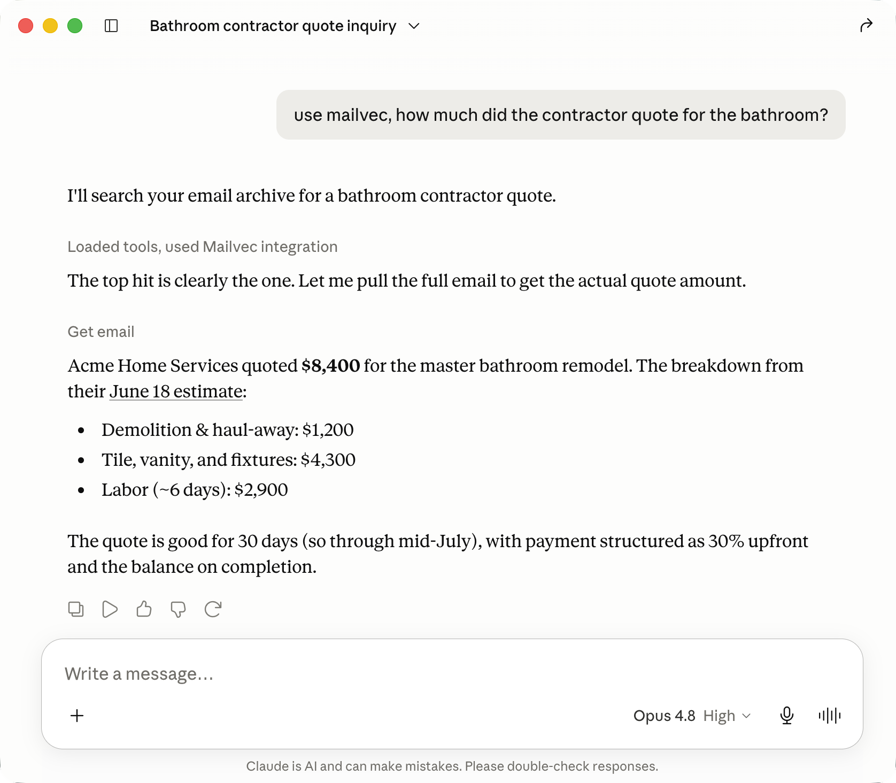

# Mailvec

**[djdelaney.github.io/Mailvec](https://djdelaney.github.io/Mailvec/)** — what it does, with diagrams.

Mailvec pulls one IMAP account into a searchable local archive and gives MCP clients access to it. Search combines keyword (FTS5) and semantic (sqlite-vec) results. [`mbsync`](https://isync.sourceforge.io/) handles the pull-only mail sync, so Fastmail, iCloud, Gmail, and other IMAP servers can be used.

   
  <em>Claude Desktop using Mailvec</em>

Screenshot uses a synthetic demo mailbox — no real mail.

## What you get

- A local Maildir and SQLite archive with keyword, semantic, and hybrid search.
- An MCP server for searching mail, reading threads, and viewing attachment text or images in Claude and other MCP clients. See [attachment capabilities](docs/attachments.md).
- A `mailvec` CLI for status, diagnostics, maintenance, and retrieval evals.

The pipeline is `IMAP → mbsync → Maildir → indexer → SQLite`; the embedder adds vectors, and the MCP server reads the archive. Mailvec runs as a Docker Compose stack, which isolates mail parsing in a separate container with no access to the archive, your credentials or the network. See the [documentation index](docs/README.md) for architecture and operator guides.

## Get started

Mailvec is deployed with Docker. Choose the machine that will hold the Maildir and database:

| Host | Start here | Client connection |
| --- | --- | --- |
| **A Mac** (Docker Desktop) | [Docker getting started → On a Mac](docs/getting-started-docker.md#on-a-mac) — compose stack plus native Ollama on the same Mac | Local: Claude Code over `127.0.0.1:3333`, Claude Desktop over `docker exec` |
| **Always-on Linux Docker host** | [Docker getting started](docs/getting-started-docker.md) — compose stack and an external Ollama host | [Remote access through Cloudflare](docs/remote-access-cloudflare.md), if you want clients outside the stack |

Both start with an IMAP account and provider-appropriate credentials (Fastmail, Gmail, and iCloud use app-specific passwords). The author's deployment runs on a Linux host. The older native macOS install (launchd services, MCPB bundle) is **deprecated**: it runs every mail parser inside the services that hold the archive and API keys. Contributors: read [local development](docs/contributing/local-dev-dataset.md) before running the install scripts on a machine that holds a frozen eval corpus.

After installation, run `docker compose exec mcp mailvec doctor` and `docker compose exec mcp mailvec status`. Keyword search works while the initial embedding pass is still running; a large archive can take hours or days to finish embedding.

## Privacy and scope

Mailvec is for one account and one owner. Ollama is the default for embeddings and OCR. Hosted embedding or OCR providers send mail content to the configured service and require an explicit opt-in. On a Linux host the MCP server publishes no host port by default; on a Mac it is published on loopback only. Read the [security model](docs/security.md) before exposing the server or enabling hosted providers.

For installation details, backups, operations, development, and design history, use the [documentation index](docs/README.md). The [changelog](CHANGELOG.md) records project history, and [CLAUDE.md](CLAUDE.md) is the contributor guide for code changes.
